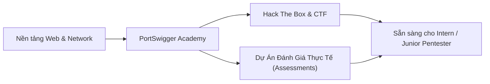

<div align="center">

# ⚔️ Offensive Web Journey
### *Web Application Penetration Testing & AppSec Field Notes*

[](https://portswigger.net/web-security)
[](https://www.hackthebox.com/)
[](docs/assessments/)
[](LICENSE)

<p align="center">
  <b>Nhật ký thực chiến, lý thuyết chuyên sâu, automation scripts và báo cáo kiểm thử ứng dụng web (AppSec / Web Pentest) phục vụ mục tiêu chuẩn bị Portfolio & CV ứng tuyển Security Intern.</b>
</p>

</div>

---

## 📌 Giới Thiệu (About Me & Journey)

Chào mừng bạn đến với **Offensive Web Journey**! Repository này được xây dựng nhằm ghi nhận toàn bộ quá trình học tập, nghiên cứu và rèn luyện kỹ năng thực chiến trong mảng **Web Application Penetration Testing**. 

Không chỉ dừng lại ở các bài lab lý thuyết, repo còn tập trung vào:
- **Tư duy khai thác (Offensive Mindset):** Hiểu rõ cơ chế hoạt động, nguyên nhân gốc rễ (Root Cause) của lỗ hổng thay vì chỉ copy payload.
- **Tự động hóa (Automation):** Viết script (Python/Bash) để tối ưu hóa quá trình PoC & khai thác (Blind SQLi, Brute-force, Fuzzing).
- **Quy trình thực chiến (Real-World Assessments):** Áp dụng phương pháp luận chuẩn (OWASP WSTG, PTES) để đánh giá các ứng dụng thực tế/demo (như Larashop, Juice Shop, DVWA).

---

## 🧭 Lộ Trình & Tiến Độ Học Tập (Roadmap)



### 1. PortSwigger Web Security Academy

| Chủ đề lỗ hổng | Mức độ hoàn thành | Labs đã giải | Ghi chú & Điểm nhấn |
| :--- | :---: | :---: | :--- |
| **SQL Injection (SQLi)** | 🟢 94% | **17 / 18** | Đã hoàn thành In-band, Union, Error-based, Blind SQLi (đang xử lý OAST) |
| **NoSQL Injection** | 🟡 Sắp học | 0 / 4 | Cú pháp BSON/JSON, auth bypass, operator injection |
| **Authentication & Access Control** | ⚪ Dự kiến | 0 / 14 | Password reset poison, MFA bypass, IDOR |
| **Cross-Site Scripting (XSS)** | ⚪ Dự kiến | 0 / 30 | Reflected, Stored, DOM-based, CSP bypass |
| **CSRF & SSRF** | ⚪ Dự kiến | 0 / 17 | Token validation bypass, cloud metadata exfiltration |

### 2. Hack The Box (HTB) & Real Labs

- **Mục tiêu:** Cày Tier 1, Tier 2 Web Challenges và Easy Linux Boxes để rèn luyện kỹ năng Recon, Chaining Vulnerabilities và Privilege Escalation.
- **Ghi chép chi tiết:** [`docs/hackthebox/`](docs/hackthebox/)

### 3. Đánh Giá & Kiểm Thử Ứng Dụng Thực Tế (Real-World Assessments)

- Thực hành kiểm thử trên môi trường web giả lập doanh nghiệp (ví dụ: **Larashop**, **OWASP Juice Shop**).
- Viết báo cáo chuẩn hóa (Executive Summary, Technical Findings, CVSS v3.1, PoC, Remediation).
- **Xem chi tiết tại:** [`docs/assessments/`](docs/assessments/)

---

## 🗂️ Cấu Trúc Thư Mục Repository

```text
├── docs/
│   ├── portswigger/            # Ghi chép từng chủ đề lab PortSwigger
│   │   ├── 01-sql-injection/   # Lý thuyết, lab breakdown, Python exploit scripts
│   │   └── ...                 # NoSQL, XSS, SSRF (cập nhật theo tiến độ)
│   ├── assessments/            # Quy trình chuẩn & báo cáo kiểm thử dự án demo (Larashop,...)
│   │   ├── pentest-workflow.md # Quy trình pentest theo chuẩn OWASP WSTG & PTES
│   │   └── larashop-demo-assessment.md # Báo cáo mẫu kiểm thử Larashop
│   ├── hackthebox/             # Writeups máy và web challenges trên HTB
│   │   └── README.md
│   ├── certifications/         # Lộ trình chứng chỉ & tài liệu ôn tập
│   │   └── README.md
│   └── methodology/            # Mindset và checklist rà soát lỗ hổng
├── scripts/                    # Các tool / exploit script tự viết (Python, Bash)
│   └── sqli/
├── templates/                  # Template chuẩn để đồng nhất format ghi chép
│   ├── lab-writeup-template.md
│   └── project-pentest-report-template.md
└── README.md
```

---

## 🛠️ Công Cụ Thường Dùng (Arsenal)

- **Proxy / Traffic Analysis:** Burp Suite Community/Pro, Caido, Wireshark.
- **Recon & Enumeration:** Nmap, FFUF, Gobuster, Amass, Katana.
- **Scripting & Exploitation:** Python 3 (requests, httpx, pwntools), Bash.
- **Browser Tools:** HackTools, Wappalyzer, FoxyProxy.

---

## ⚠️ Disclaimer

*Mọi kiến thức, công cụ, và mã khai thác trong repository này được thực hiện vì mục đích giáo dục và nghiên cứu bảo mật hợp pháp trong các môi trường được cấp phép (PortSwigger Academy, Hack The Box, local labs). Tác giả không chịu trách nhiệm cho các hành vi sử dụng trái phép.*
