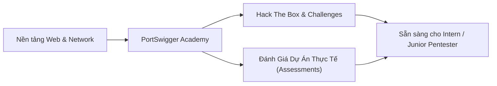

<div align="center">

# ⚔️ Offensive Web Journey
### *Web Application Penetration Testing & AppSec Field Notes*

[](docs/portswigger/)
[](docs/hackthebox/)
[](docs/assessments/)
[](LICENSE)

<p align="center">
  <b>Nhật ký thực chiến, lý thuyết chuyên sâu, automation scripts và báo cáo kiểm thử ứng dụng web phục vụ mục tiêu chuẩn bị Portfolio & CV ứng tuyển Security / Pentest Intern.</b>
</p>

</div>

---

## 📌 Giới Thiệu (About Me & Journey)

Chào mừng bạn đến với **Offensive Web Journey**! Repository này được xây dựng nhằm ghi nhận toàn bộ quá trình học tập, nghiên cứu và rèn luyện kỹ năng thực chiến trong mảng **Web Application Penetration Testing**.

Mọi nội dung trong repo đều tập trung vào 3 giá trị cốt lõi:
- **Tự đúc kết lý thuyết (Self-written Foundation):** Hiểu rõ bản chất lỗ hổng, cơ chế hoạt động và nguyên nhân gốc rễ (Root Cause) thay vì chỉ sao chép payload máy móc.
- **Tự động hóa (Automation & PoC):** Tự viết script (Python/Bash) để tự động hóa quá trình dò quét và khai thác (Blind SQLi, Brute-force).
- **Quy trình thực chiến (Real-World Assessments):** Nắm vững phương pháp luận kiểm thử theo chuẩn quốc tế (OWASP WSTG, PTES).

---

## 🧭 Lộ Trình & Tiến Độ Học Tập



### 1. [PortSwigger Web Security Academy](docs/portswigger/)
Khu vực ghi chép lý thuyết tự đúc kết, write-up từng bài lab và script PoC phân theo từng module lỗ hổng:
- **[SQL Injection (SQLI)](docs/portswigger/SQLI/):** 17/18 Labs Solved (In-band, Union, Error-based, Blind SQLi).
- **NoSQL Injection:** Sắp học.
- **Authentication, XSS, CSRF, SSRF,...:** Lộ trình tiếp theo.

### 2. [Hack The Box (HTB)](docs/hackthebox/)
Trang tổng quan và write-up các phòng máy (Boxes) và thử thách Web (Challenges) để rèn luyện tư duy recon và chaining vulnerabilities.

### 3. [Quy Trình Pentest Thực Tế (Assessments)](docs/assessments/)
Tài liệu hóa quy trình kiểm thử thâm nhập theo chuẩn công nghiệp (OWASP WSTG & PTES) và không gian lưu trữ báo cáo kiểm thử các dự án demo sau này.

---

## 🗂️ Cấu Trúc Thư Mục Repository

```text
├── docs/
│   ├── portswigger/            # Tổng quan PortSwigger Academy
│   │   ├── README.md           # Bảng tổng hợp các chủ đề lab
│   │   └── SQLI/               # Thư mục chuyên đề SQLi (lý thuyết, writeups, scripts)
│   │       └── README.md
│   ├── hackthebox/             # Tổng quan Hack The Box & thư mục con cho từng Box
│   │   └── README.md
│   ├── assessments/            # Phương pháp luận kiểm thử thực chiến
│   │   └── pentest-workflow.md # Quy trình pentest chuẩn OWASP WSTG & PTES
│   └── methodology/            # Mindset và checklist kiểm thử
├── scripts/                    # Các script tự code phục vụ khai thác PoC
│   └── sqli/
├── templates/                  # Template chuẩn để ghi chép lab & báo cáo
│   ├── lab-writeup-template.md
│   └── project-pentest-report-template.md
└── README.md
```

---

## 🛠️ Công Cụ Thường Dùng (Arsenal)

- **Proxy / Traffic Analysis:** Burp Suite Community/Pro, Caido.
- **Recon & Enumeration:** Nmap, FFUF, Gobuster, Katana.
- **Scripting & Automation:** Python 3 (requests, httpx), Bash.
- **Browser Extensions:** HackTools, Wappalyzer, FoxyProxy.

---

## ⚠️ Disclaimer

*Mọi kiến thức, công cụ, và mã khai thác trong repository này được thực hiện vì mục đích giáo dục và nghiên cứu bảo mật hợp pháp trong các môi trường được cấp phép (PortSwigger Academy, Hack The Box, local labs). Tác giả không chịu trách nhiệm cho các hành vi sử dụng trái phép.*
