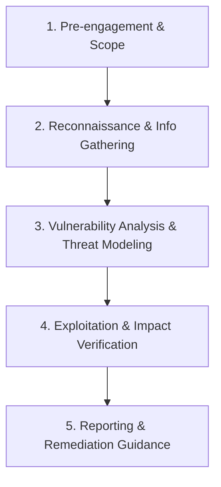

# 🏢 Pentest Workflow & Assessment Methodology

Phương pháp luận kiểm thử thâm nhập ứng dụng web được xây dựng dựa trên sự kết hợp giữa **OWASP Web Security Testing Guide (WSTG)** và **Penetration Testing Execution Standard (PTES)**.

---

## 🔄 Quy Trình 5 Giai Đoạn (5-Phase Assessment Lifecycle)

### Giai đoạn 1: Xác Định Phạm Vi & Ranh Giới (Scoping & Rules of Engagement)
- **Scope Definition:** Domain, Subdomain, IP Ranges, API endpoints được phép test.
- **Out-of-Scope:** Những dịch vụ của bên thứ ba (Third-party payments, CDN), DoS/DDoS, Social Engineering.
- **Testing Type:** Black-box, Grey-box (có tài khoản user thường), hoặc White-box.

### Giai đoạn 2: Thu Thập Thông Tin (Reconnaissance & Mapping)
- **Technology Stack Identification:** Web server (Nginx/Apache), Framework (Laravel, Express, Spring Boot), Database (MySQL, PostgreSQL, MongoDB).
- **Endpoint Enumeration:** Content discovery (FFUF, dirsearch), sitemap crawling, hidden parameters discovery (Arjun).
- **Authentication Flow:** Cơ chế session (JWT, cookies, OAuth2), phân quyền Role-Based Access Control (RBAC).

### Giai đoạn 3: Phân Tích Lỗ Hổng (Vulnerability Assessment)
- Kiểm tra các lỗi logic nghiệp vụ (Business Logic Flaws).
- Rà soát theo danh mục **OWASP Top 10 / WSTG**:
  - A01: Broken Access Control (IDOR, Privilege Escalation).
  - A02: Cryptographic Failures.
  - A03: Injection (SQLi, NoSQLi, Command Injection).
  - A07: Identification and Authentication Failures.

### Giai đoạn 4: Khai Thác & Đo Lường Tác Động (Exploitation & Impact)
- Xây dựng **Proof-of-Concept (PoC)** chứng minh lỗ hổng tồn tại.
- Đo lường tác động thực tế (Confidentiality, Integrity, Availability) mà không làm gián đoạn hệ thống.
- Chaining lỗ hổng (kết hợp nhiều lỗi mức Low/Medium thành High/Critical).

### Giai đoạn 5: Báo Cáo & Khắc Phục (Reporting & Remediation)
- **Executive Summary:** Tóm tắt dành cho ban quản lý / khách hàng (mức độ rủi ro chung, biểu đồ phân bổ).
- **Technical Breakdown:** Mô tả chi tiết từng lỗ hổng, CVSS v3.1 score, các bước tái hiện (Steps to Reproduce), và giải pháp khắc phục cụ thể theo từng ngôn ngữ/framework.
